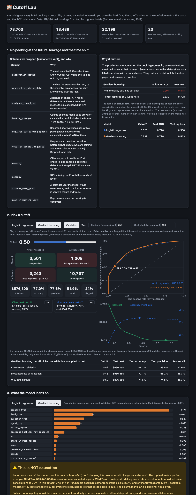

# Cutoff Lab 🏨

A model scores every hotel booking with a probability of being canceled. **Where should you draw the line?** This interactive page lets you drag the cutoff and watch the following update live:

- the confusion matrix
- the dollar cost (with editable false-positive and false-negative costs)
- precision, recall, accuracy and the ROC point

It compares **logistic regression** with **gradient boosting**, trained on real data with an honest time split and no leaky features. It's HW4 Part 4C on a real dataset.



## Data

[Hotel booking demand](https://www.sciencedirect.com/science/article/pii/S2352340918315191) (Antonio, Almeida & Nunes, *Data in Brief* 22, 2019). It has 119,390 bookings from a city hotel and a resort hotel in Portugal, with arrivals from Jul 2015 to Aug 2017, and 37% of them were canceled. `./get_data.sh` downloads it from the TidyTuesday mirror; it isn't committed.

## Method

**Prediction point:** the moment the booking comes in. Every feature must be known then.

**Time-based split** by arrival date (never shuffled):

| Split | Arrivals | Bookings | Canceled |
|---|---|---|---|
| Train | Jul 2015 – Dec 2016 | 78,703 | 36.2% |
| Validation (pick the cutoff) | Jan – Apr 2017 | 18,489 | 36.5% |
| Test (report) | May – Aug 2017 | 22,198 | 40.5% |

**Leakage: dropped columns** (each reason is checked in the data):

| Column | Why it's dropped |
|---|---|
| `reservation_status`, `reservation_status_date` | the outcome itself, and its date |
| `assigned_room_type` | set at check-in (5% cancel when it differs from the reserved room, vs 42%) |
| `booking_changes` | counts changes up to arrival or cancellation |
| `required_car_parking_spaces` | recorded at arrival: **0.0%** cancellation when > 0 |
| `total_of_special_requests` | can be added until arrival; dropped to be safe |
| `country` | often confirmed only at check-in; canceled bookings default to PRT (57% vs 24%) |
| `company` | 94% missing |
| `arrival_date_year` | a year the model will never see again |

Putting the leaky columns back raises gradient boosting's validation AUC from **0.839 to 0.904**: a better score on paper for a model that couldn't run in production.

**Models** (`train.py`, scikit-learn):
- **Logistic regression:** one-hot categories plus standardized numerics.
- **Histogram gradient boosting:** 400 trees, learning rate 0.06.
- **Agent IDs:** the top 20 agents (counted on training data only) become categories, and the rest are "other".

| Model | Validation AUC | Test AUC |
|---|---|---|
| Logistic regression | 0.826 | 0.770 |
| Gradient boosting | 0.839 | 0.798 |

AUC falls on test because summer 2017 cancels more (40.5% vs 36%). That drift is realistic, and the time split is what exposes it.

## What the page shows

- **Cutoff slider** with a live confusion matrix, costs, accuracy, precision, recall, the share flagged, and the ROC point on both models' curves.
- **Cost by cutoff** and **accuracy by cutoff**, with the **cheapest** and **most accurate** cutoffs marked. A "Go" button jumps to each.
- **Validation → test transfer:** the honest way to choose a cutoff. Pick it on validation, then see what it does on test.

  With the default costs (false positive = walking a guest, $250; false negative = an empty room, $100), gradient boosting's cheapest validation cutoff is **0.82**. On test it costs **$696,750**, against $836,550 at 0.50 and $986,450 at the most accurate cutoff (0.45).
- **Break-even cutoff** for calibrated scores: cFP / (cFP + cFN) = 250/350 = 0.71.
- **Feature importance** (permutation, AUC drop on validation), with a big **"This is NOT causation"** note.

  The top feature, `deposit_type`, shows **99.4%** cancellation for non-refundable bookings against 28.4% with no deposit. That isn't because deposits cause cancellations: 97% of non-refundable bookings are group blocks or offline-agent bookings made about 6 months ahead.

## Tests

```
node test.mjs                    # 29 checks: page metrics vs scikit-learn
.venv/bin/python test_train.py   # 7 checks: split, leakage, preprocessing
```

**`test.mjs`:**
- **Confusion matrices:** computed from the page's 1,000-bin score histograms, they equal scikit-learn's exact counts at cutoffs 0.3, 0.5 and 0.7, for both models on both splits.
- **AUC:** the binned AUC equals `roc_auc_score` to 4 decimals.
- **Definitions:** metric definitions match a hand-made example, and the trapezoid AUC equals pair counting with ties.
- **Optima:** the cheapest and most accurate cutoffs are true optima of the sweep.
- **Cost direction:** a higher false-positive cost pushes the cutoff up.
- **Hygiene:** no dropped column is used, and the split is ordered.

**`test_train.py`:**
- **Split:** every booking lands in exactly one split, in time order.
- **Features:** no leaky column is used, and top agents come from training data only.
- **Missing values:** none in the features.
- **Leakage evidence:** parking > 0 never cancels.

## Run

```
./get_data.sh
python3 -m venv .venv && .venv/bin/pip install -r requirements.txt
.venv/bin/python train.py          # writes data.js and report.json (~35 s)
open index.html
```

`data.js` is committed, so `index.html` works without retraining (and on GitHub Pages).
